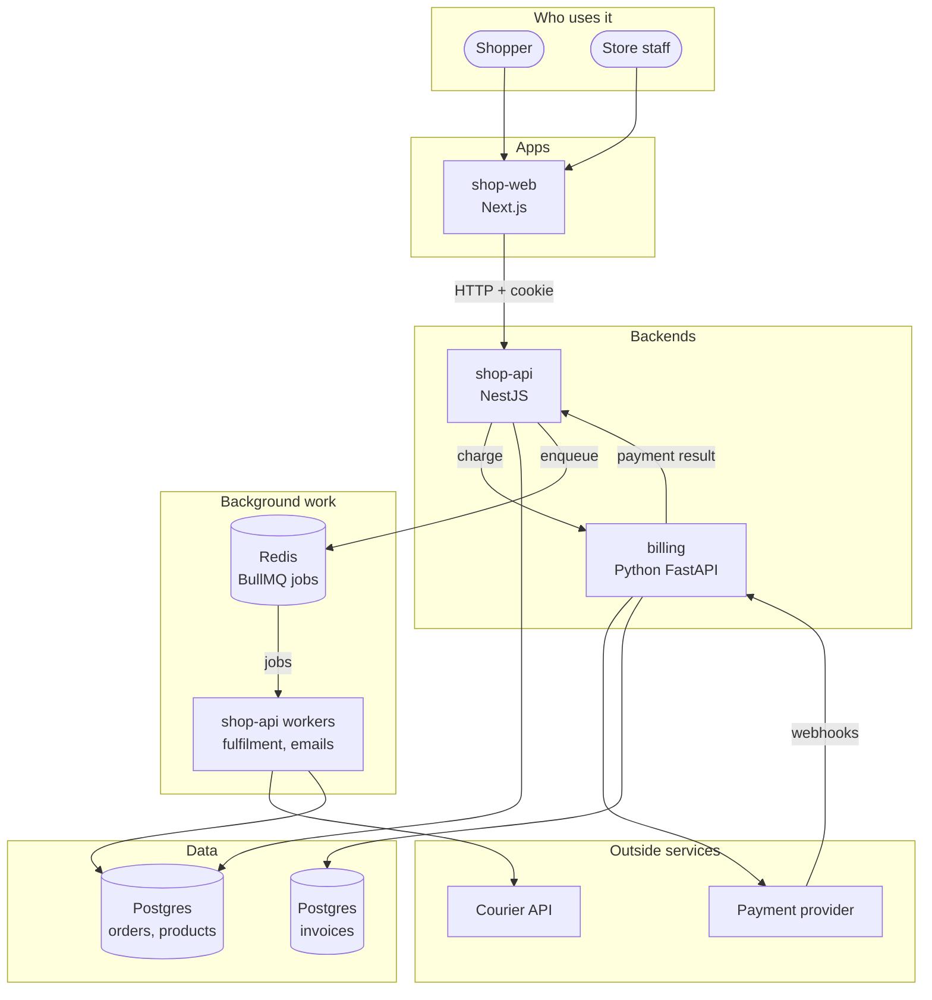

# System map (start here)

Acme Shop sells furniture online. Shoppers use the storefront, staff use the admin pages in the same Next.js app,
and both talk to shop-api. Payments go through a separate Python billing service and an outside payment provider.

## The boxes

| Box | What it is | Read |
|---|---|---|
| shop-web | Storefront and admin pages, one Next.js app | [Sign-in](../flows/sign-in.md) |
| shop-api | The main API: products, carts, orders, users | [shop-api architecture](shop-api.md) |
| billing | Charges, refunds and invoices; the only code that talks to the payment provider | [0001](../decisions/0001-separate-billing-service.md) |
| Redis + workers | Background jobs: fulfilment, emails, stock sync | [Order fulfilment](../flows/order-fulfilment.md) |
| infra | Terraform for all of the above on AWS (not drawn) | [Module catalog](../modules/catalog.md) |

## Start here by task

| I need to… | Read, in this order |
|---|---|
| Understand the system | This page → [shop-api architecture](shop-api.md) |
| Fix "customer was charged twice" | [Checkout](../flows/checkout.md) → [the March incident](../incidents/2026-03-duplicate-charges.md) |
| Fix "order paid but never shipped" | [Order fulfilment](../flows/order-fulfilment.md) |
| Add an API endpoint | [shop-api architecture → How to add a module](shop-api.md) |

## Main flows at a glance

- [Sign-in](../flows/sign-in.md): password check, session cookie, guards
- [Checkout](../flows/checkout.md): cart to paid order
- [Order fulfilment](../flows/order-fulfilment.md): paid order to shipped parcel
