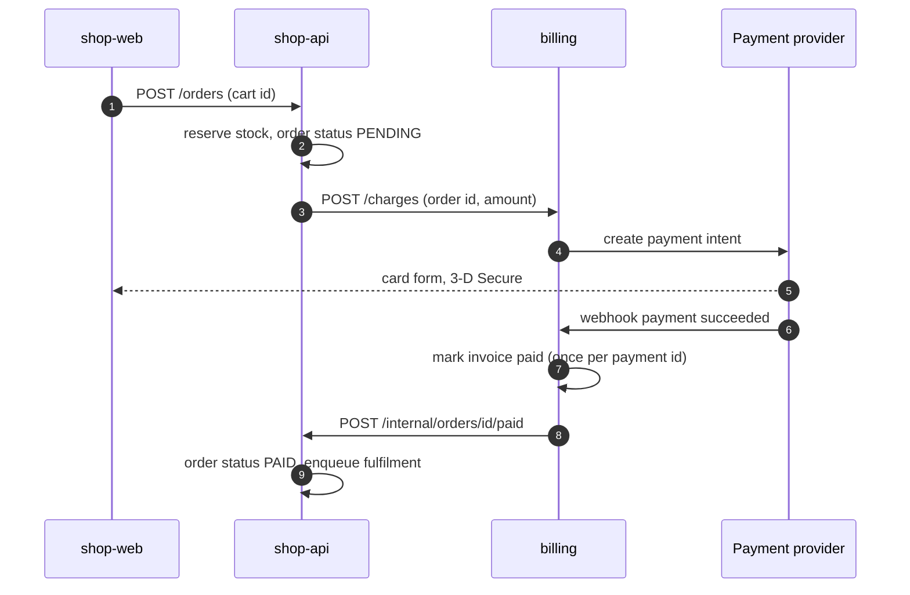

# Checkout

From a full cart to a paid order. shop-api owns the order; the billing service owns the money.

## At a glance

## Steps

1. `shop-api:src/modules/orders/orders.service.ts → createOrder` reserves stock and saves a `PENDING` order.
2. It asks billing for a charge (`billing:app/routers/charges.py → create_charge`).
3. The payment provider calls billing's webhook (`billing:app/routers/webhooks.py → payment_webhook`), which checks the
   signature and marks the invoice paid.
4. Billing tells shop-api the order is paid (`shop-api:src/modules/orders/orders.internal.controller.ts → markPaid`).

> Risk: reserved stock is only released by a nightly job, so an abandoned checkout holds stock for up to a day. Untested.

> Risk: `markPaid` doesn't check the order is still `PENDING`; a late webhook for a cancelled order would set it
> back to `PAID`. Untested.

See [the March incident](../incidents/2026-03-duplicate-charges.md) for why billing de-duplicates by payment id.
