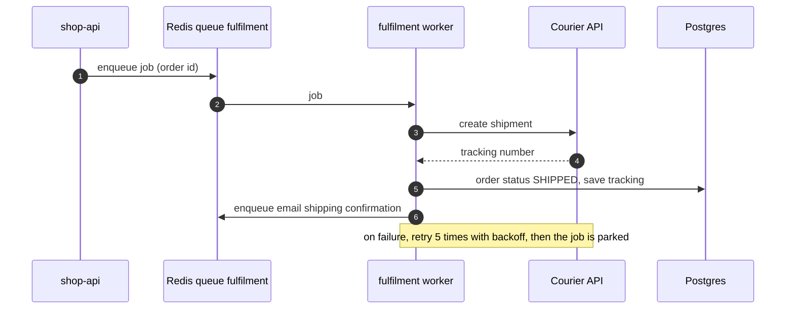

# Order fulfilment

From a paid order to a shipped parcel, through the `fulfilment` job queue.

## At a glance

## Steps

1. `shop-api:src/jobs/fulfilment.processor.ts → FulfilmentProcessor` takes the job.
2. It calls the courier (`shop-api:src/integrations/courier.client.ts → createShipment`).
3. Retries come from the queue settings (`shop-api:src/jobs/queues.ts → QUEUES`).
4. Redis is `infra:modules/redis/main.tf → aws_elasticache_cluster.jobs`.

> Risk: a parked job is only visible in the Redis dashboard; nothing alerts staff, so a paid order can sit unshipped. Untested.
