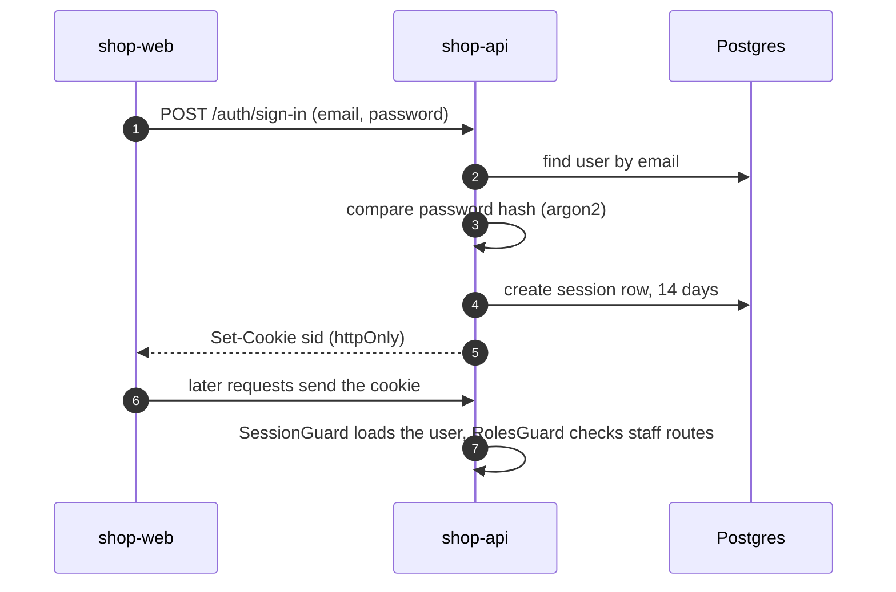

# Sign-in

How shoppers and staff sign in. Both use the same form and the same session cookie; staff pages also check the role.

## At a glance

## Steps

1. The form posts to `shop-api:src/modules/auth/auth.controller.ts → signIn`.
2. The password is checked with argon2 (`shop-api:src/modules/auth/auth.service.ts → verifyPassword`).
3. A session row is written and its id is sent as an httpOnly cookie.

> Risk: there is no rate limit on `/auth/sign-in`, so passwords can be guessed quickly. Untested.

> Unverified: whether the load balancer adds its own rate limit. The infra repo doesn't show one.
