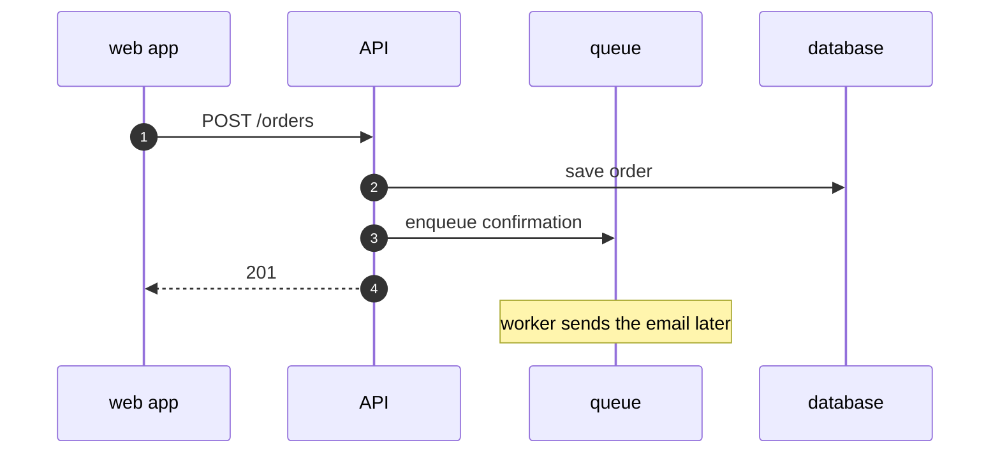

# <Title>

<Two or three sentences: what this flow does, who starts it, where it ends.>

## At a glance

<!-- 6–15 steps, one per real call between components, in order. Keep the details for the Steps section. -->

## Steps

1. **<Actor or trigger>** <what happens> (`<prefix>:<path> → <symbol>`).
2. ...

## Failure points

| Where it fails | What the user sees | What is left behind | Recovery |
|---|---|---|---|
| | | | |

## Gotchas

- ...

<!-- Use "> Risk: ..." for possible bugs (say "Untested") and "> Unverified: ..." for claims the code can't confirm. -->
