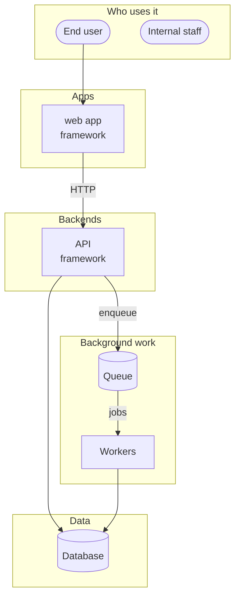

# System map (start here)

<One or two sentences: what the system is, who uses it, and what it talks to.>

<!-- Draw layers top to bottom: who uses it → apps → backends → background work → data, with outside services on the
     side. Keep it to about 15 arrows; list the connections you leave out in the table below. Add a `click` line for
     every box so it opens its wiki page in site/system-map.html. -->

## The boxes

| Box | What it is | Read |
|---|---|---|
| | <one line; mention connections not drawn> | <links> |

## Start here by task

| I need to… | Read, in this order |
|---|---|
| Understand the system | This page → <architecture pages> |
| Fix "<the most common production problem>" | <flow page> → <incident page> |
| Add a <screen / endpoint / table> | <architecture page → "How to add a module"> |

## Main flows at a glance

Each of these pages starts with an "At a glance" sequence diagram.

- [<Flow>](../flows/<flow>.md): <one line>
